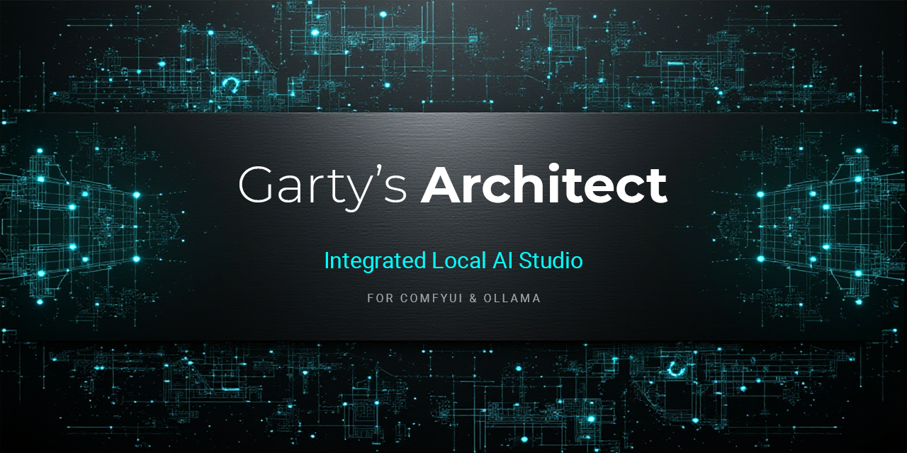

<div align="center">
  
</div>
<br>

# 🏛️ Garty's Architect — Estudio de IA Local Integrado

[-0078D6?style=for-the-badge&logo=windows)](https://github.com/Gartyl/Gartys-Architect/releases)
[](https://frankenphp.dev/)
[](https://github.com/Gartyl/Gartys-Architect/wiki)
[](https://github.com/Gartyl/Gartys-Architect)

<p align="center">
  <b>🌐 Language / Idioma:</b> &nbsp; <a href="README.md">🇬🇧 <b>English</b></a> &nbsp;|&nbsp; 🇪🇸 <b>Español</b>
</p>

Bienvenido al repositorio oficial de **Garty's Architect**, tu centro de mando de escritorio para orquestar modelos de Inteligencia Artificial en local. Diseñado para unir la potencia bruta e ilimitada de **ComfyUI + Ollama** con la experiencia limpia, ágil y enfocada de un estudio creativo profesional.

**Garty's Architect** se distribuye como una **aplicación 100% portátil y autónoma** impulsada por un servidor **FrankenPHP** embebido y **SQLite3**. Sin conflictos de entornos Python, sin instalaciones de Apache/XAMPP y sin contenedores Docker. Solo descomprimir, lanzar y crear.

> ⚠️ **Nota importante:** Garty's Architect es un orquestador avanzado e interfaz de estudio. **No** distribuye, aloja ni incluye modelos de IA ni checkpoints. Tú mantienes el control total sobre tus propios modelos locales.

---

## ⚡ Características Principales

* 💬 **Súper-Chat Multimodal Unificado y RAG:** Controla ComfyUI y Ollama desde una única interfaz en modo oscuro. Analiza documentos PDF/DOCX, realiza extracción OCR de alta precisión sobre imágenes, consulta internet en tiempo real con el motor **RAG Francotirador** (API de Wikipedia + DuckDuckGo Lite), personaliza roles de Chat y lanza renders a la GPU mediante comandos directos (`/img`, `/gpu`). ¡Despídete de los nodos espagueti!
* 🎨 **Estudio Completo de Imagen Moderna (Gratis):** Orquesta checkpoints clásicos (**SD 1.5, SDXL**) y arquitecturas DiT/desmembradas modernas (**Flux, Flux 2/3 Klein, Chroma, Z-Image, Anima, SD 3.5, Krea-2, Qwen-Image/Edit, Hunyuan Image, HiDream, MiniMax H3 Image, Fibo 2.0**) con Flow Shift universal, Presets Personales, ControlNet Studio, ADetailer, Inpainting/Outpainting y Escalado Clásico por bloques.
* 🤖 **El Auto-Arquitecto (Enrutamiento Semántico en 1-Clic — PRO):** ¿No sabes qué modelo, resolución o CFG elegir? Escribe tu idea en lenguaje natural y pulsa la Varita Mágica. Tu LLM local lee las etiquetas semánticas de tus modelos instalados, selecciona el motor idóneo, ajusta la proporción, redacta el prompt técnico y dispara la GPU automáticamente.
* 🎬 **Estudio de Vídeo Cinemático de Última Generación (PRO):** Orquestación nativa para **Wan 2.1/2.2, LTX-Video, Hunyuan Video y MiniMax H3** (incluyendo conmutación automática `.safetensors` / `.gguf`, puenteo inteligente de LoRAs, Fusión de Vídeo e inyección multimodal de hasta 9 imágenes de referencia en un mismo disparo).
* 🔊 **Estudio Pro de Audio, Clonación de Voz y Foley (PRO):** Clona voces con **MiniMax H3 (20B)** (decodificación ultrarrápida de solo audio + recorte automático de silencios vía FFmpeg), **OmniVoice** (Modo Dual: Diseño Zero-Shot + Clonación por referencia), **IndexTTS-2** y **F5-TTS**. Genera efectos sonoros sincronizados con vídeo mediante **HunyuanVideo-Foley**, música con **Stable Audio** y partituras descriptivas con el **Maestro Musical IA**.
* 🧠 **Historial Vectorial Semántico y Wildcards YAML:** Cada prompt y respuesta del chat se indexa automáticamente mediante *embeddings* locales (`nomic-embed-text`), permitiéndote buscar en tu historial por *significado y concepto*, no solo por palabras exactas. Soporta sintaxis dinámica `{a|b|c}` y árboles de comodines `.yaml`.
* 🔋 **Monitor de Hardware en Vivo y Árbitro Inteligente de VRAM:** Supervisa GPU/VRAM/RAM en tiempo real y configura políticas `keep_alive` por modelo para que Ollama libere la VRAM al instante (`0s`) antes de que ComfyUI inicie un render pesado. Incluye actualizador OTA desde GitHub que protege tus archivos personales y borrado físico seguro (enviando los modelos obsoletos a la **Papelera de Reciclaje de Windows**).
* 🌍 **Multilingüe y 100% Privado:** Soporte nativo en **Español, Inglés y Catalán** (con editor de traducciones en vivo integrado). Tus datos, tu hardware, tus reglas.

---

## 💻 Requisitos de Hardware

Dado que Garty's Architect se comunica directamente con tus instancias locales de IA, el rendimiento depende íntegramente de tu máquina:

* **Equipo Mínimo (SD 1.5 / SDXL / LLMs de 8B):**
  * **CPU:** Procesador moderno de 4 núcleos.
  * **GPU:** Tarjeta gráfica NVIDIA con **8 GB VRAM**.
  * **RAM:** 16 GB de memoria del sistema.
* **Equipo Recomendado (Flux / DiT / Generación de Vídeo / LLMs de 14B–27B):**
  * **CPU:** Procesador multinúcleo moderno (ej. Intel Core i7 / AMD Ryzen 7 o superior).
  * **GPU:** Serie NVIDIA RTX con **16 GB+ VRAM** (ej. RTX 4060 Ti 16GB, RTX 5060 16GB, RTX 4080, RTX 3090/4090).
  * **RAM:** 32 GB+ de memoria del sistema.

---

## 🛠️ Inicio Rápido e Instalación

Ponerlo en marcha lleva menos de un minuto — **sin editar archivos de configuración a mano**:

1. Descarga el último archivo **`.zip` de Garty's Architect** desde la pestaña **[Releases](../../releases)**.
2. Descomprime el contenido en una carpeta no protegida de tu disco duro (ej. `C:\GartysArchitect\`). *Evita `C:\Archivos de programa\` para garantizar permisos de escritura para SQLite y la galería.*
3. Asegúrate de tener **[Ollama](https://ollama.com)** (`11434`) y **ComfyUI** (`8188`) abiertos en segundo plano.
4. Haz doble clic en **`GartysArchitect.exe`**. Creará automáticamente tu `config.php` local, arrancará el servidor FrankenPHP embebido y **abrirá tu navegador** en `http://localhost:8000` *(mantén abierta la ventana de consola mientras uses la aplicación)*.
5. En la pantalla de **Onboarding Inteligente**:
   * Confirma o selecciona tu carpeta **`ComfyUI/models`** en 1 clic (se autodetectan rutas habituales de Windows, ComfyUI Portable y StabilityMatrix).
   * Opcionalmente descarga el LLM base (`Llama 3.1 8B + Nomic Embed`) y/o un checkpoint SDXL inicial con barra de progreso en vivo, o entra directamente si ya tienes tus propios modelos.
6. *(Opcional)* Introduce tu **★ Clave de Licencia PRO** en la barra superior para desbloquear Vídeo, Audio Pro, Auto-Arquitecto y módulos avanzados de estudio. *(Si usas el Descargador de Civitai PRO, puedes pegar también tu API Key de Civitai en `config.php` dentro de `API_KEY`.)*

---

## 🧠 Requisito 1: El Motor Lógico (Ollama)

Garty's Architect es **100% agnóstico respecto a los modelos**: puedes registrar cualquier modelo que ya tengas desde el Panel de Administración. Si empiezas desde cero, estos roles base cubren todos los flujos:

1. **`sys_llm` (Ingeniero de Prompts y Auto-Arquitecto):** `llama3.1:8b` *(o `gemma3:12b` / `deepseek-r1:14b`)*
2. **`sys_vision` (Analista Óptico):** `granite3.2-vision` *(extrae etiquetas estructurales para ControlNet/IP-Adapter)*
3. **Modelo de Chat Multimodal:** `qwen2.5-vl:7b` *(o `gemma3:27b` — chat, programación y OCR de alta precisión)*
4. **`sys_embed` (Búsqueda Vectorial Semántica):** `nomic-embed-text:latest` *(274 MB — indexa el historial por concepto)*

```powershell
ollama pull llama3.1:8b
ollama pull granite3.2-vision
ollama pull qwen2.5-vl:7b
ollama pull nomic-embed-text:latest
```

*(Los nuevos usuarios también pueden instalar `llama3.1:8b` + `nomic-embed-text` en **1 clic** directamente desde la pantalla de Onboarding Inteligente.)*

---

## 🎨 Requisito 2: El Motor Gráfico (ComfyUI y FFmpeg)

### Listo para empezar (0 Custom Nodes obligatorios)
La generación de imagen estándar (**SD 1.5, SDXL, Flux y arquitecturas DiT nativas de ComfyUI**) funciona de inmediato con una instalación limpia de ComfyUI, sin necesidad de instalar nodos extra para tus primeros renders.

### Custom Nodes opcionales (instala solo los módulos que vayas a usar)
Instálalos desde **ComfyUI Manager** según lo que necesites (junto con **FFmpeg** en el `PATH` del sistema para fusión de vídeo y recorte de muestras de voz):

* **Modelos Cuantizados (.gguf):** `ComfyUI-GGUF`
* **Control Estructural, Reparación y Escalado:** `ComfyUI-Advanced-ControlNet`, `comfyui_controlnet_aux`, `ComfyUI-Impact-Pack` *(ADetailer / Inpaint)*, `ComfyUI_UltimateSDUpscale`
* **Edición Avanzada de Imagen:** `ComfyUI-Flux2KontextConditioner`, `ComfyUI-Qwen-Image-Edit`
* **Post-Procesado y Estilo PRO:** `ComfyUI-ReActor` *(FaceSwap)*, `ComfyUI_IPAdapter_plus`, `ComfyUI-Rembg`, `ComfyUI-IC-Light`, `ComfyUI-DDColor`, además de los nodos de SeedVR2 / AuraSR / LaMa si los utilizas
* **Empaquetado de Vídeo PRO:** `ComfyUI-VideoHelperSuite` *(Obligatorio para unir MP4 y Audio)*
* **Clonación de Voz, Foley y Lip-Sync PRO:** `ComfyUI-MiniMax-H3`, `ComfyUI-OmniVoice`, `ComfyUI-IndexTTS`, `ComfyUI-F5-TTS`, `ComfyUI-HunyuanVideo-Foley`, `ComfyUI-Wav2Lip`

---

## 🚀 Ediciones: Free vs. PRO

### 1. The Core Experience (Gratuita)
Todo lo necesario para operar un estudio completo de imagen y chat IA en local, sin limitar las arquitecturas modernas:
* **Todas las Arquitecturas de Imagen:** Clásicas (**SD 1.5 y SDXL**) y modernas **Flux / DiT / Desmembradas** (Flux, Flux 2/3 Klein, Chroma, Z-Image, Anima, SD 3.5, Krea-2, Qwen-Image/Edit, Hunyuan Image, HiDream, MiniMax H3 Image, Fibo 2.0) con Flow Shift y Presets Personales.
* **Estudio Gráfico Base:** **ControlNet Studio**, **Reparador (ADetailer)**, **Lienzo de Inpainting y Outpainting**, **Escalado Clásico por bloques** y Bandeja Multicarga (hasta 2 imágenes).
* **Súper-Chat y Prompts:** Chat Multimodal, Personalidades de Chat personalizables, búsqueda web RAG Francotirador, análisis de Documentos/OCR, Arquitecto de Prompts, Dado Sorpresa, Prompts Dinámicos/Wildcards e Historial Vectorial Semántico (`nomic-embed-text`).
* **Sistema y Onboarding:** Monitor de Hardware/VRAM en vivo, Onboarding Inteligente en 1-Clic, base de datos portátil SQLite e interfaz multilingüe (ES/EN/CA).
* 👉 **[Descarga el último `.zip` desde Releases](../../releases)**

### 2. ★ Licencia PRO Studio
Diseñada para creadores avanzados, cineastas y flujos de audio/vídeo. Desbloquea todo el arsenal de Garty's Architect:
* **Estudio de Vídeo Cinemático:** **Wan 2.1/2.2, LTX-Video, Hunyuan Video y MiniMax H3**, Fusión de Vídeo, Semillas y Estilos de vídeo, y Bandeja Multicarga ampliada (hasta el límite del motor: 3–9 imágenes).
* **Suite Completa de Audio y Clonación de Voz:** **Clonación Vocal MiniMax H3 (20B), OmniVoice Modo Dual, IndexTTS-2, F5-TTS**, gestor de Voces Guardadas, **HunyuanVideo-Foley, Stable Audio, Maestro Musical IA y Wav2Lip**.
* **Auto-Arquitecto y Productividad Avanzada:** **Auto-Arquitecto semántico en 1-Clic**, procesado por **Carpeta Batch**, **Bucle Infinito (∞)**, **XY Lab**, **Benchmarks** y **Descargador integrado de Civitai**.
* **Restauración y Post-Procesado PRO:** **SeedVR2** (restauración de imagen y vídeo), **AuraSR**, **LaMa Object Remover**, **ReActor (FaceSwap)**, **IP-Adapter / Flux Redux**, **IC-Light**, **DDColor** y **Rembg**.
* 👉 **[Desbloquea la Licencia PRO aquí](https://garty.lemonsqueezy.com/checkout/buy/70636e1a-0dde-49c5-bf97-d4d852dceee8)**

---

## 📖 Documentación Oficial y Wiki

Cada función —desde configurar modelos DiT/UNET desmembrados y dominar los 4 motores de clonación de voz hasta políticas de VRAM y solución de problemas— está documentada en la Wiki oficial:

👉 **[Lee el Manual Técnico Completo en la Wiki Oficial](../../wiki)**

---

## 🔮 Hoja de Ruta (Roadmap)

* **Evolución Continua de Motores:** Integración desde el primer día de las nuevas arquitecturas abiertas de imagen, vídeo y audio.
* **Edición Servidor (Server Edition):** Versión dedicada multiusuario pensada para redes de estudio, con soporte para MySQL/MariaDB, permisos por roles, galerías compartidas y registros de auditoría.

---

## 🐛 Reporte de Errores y Sugerencias

¿Tienes una idea o has encontrado un bug? Abre un ticket en **[Issues](../../issues)**. Antes de reportar un fallo de renderizado, verifica en la [Wiki de Solución de Problemas](../../wiki) que tu ruta `ComfyUI/models`, los Custom Nodes opcionales y los modelos de Ollama estén correctamente configurados.