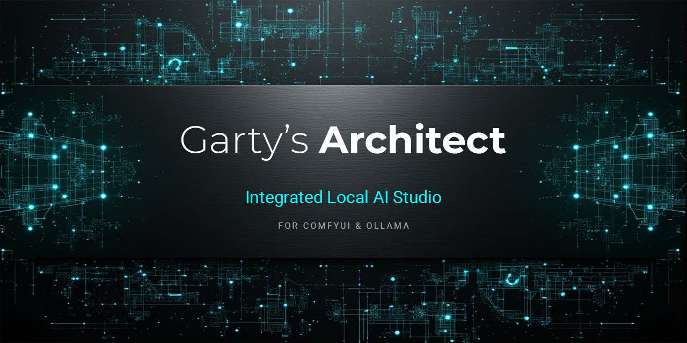

<div align="center">
  
</div>
<br>
# 🏛️ Garty's Architect — Estudio de IA Local Integrado

[-0078D6?style=for-the-badge&logo=windows)](https://github.com/Gartyl/Gartys-Architect/releases)
[](https://frankenphp.dev/)
[](https://github.com/Gartyl/Gartys-Architect/wiki)
[](https://github.com/Gartyl/Gartys-Architect)

<p align="center">
  <b>🌐 Language / Idioma:</b> &nbsp; <a href="README.md">🇬🇧 <b>English</b></a> &nbsp;|&nbsp; 🇪🇸 <b>Español</b>
</p>

Bienvenido al repositorio oficial de **Garty's Architect**, tu centro de mando definitivo de escritorio para orquestar modelos de Inteligencia Artificial en local. Diseñado para unir la potencia bruta e ilimitada de **ComfyUI + Ollama** con la experiencia limpia, ágil y enfocada de un estudio de diseño profesional.

**Garty's Architect** se distribuye como una **aplicación 100% portátil y autónoma** impulsada por un servidor **FrankenPHP** embebido y **SQLite3**. Sin conflictos de entornos Python, sin instalaciones de Apache/XAMPP y sin contenedores Docker. Solo descomprimir, lanzar y crear.

> ⚠️ **Nota importante:** Garty's Architect es un orquestador avanzado e interfaz de estudio. **No** distribuye, aloja ni incluye modelos de IA ni checkpoints. Tú mantienes el control total sobre tus propios modelos locales.

---

## ⚡ Características Principales

* 💬 **Súper-Chat Multimodal Unificado y RAG:** Controla ComfyUI y Ollama desde una única interfaz en modo oscuro. Analiza documentos PDF/DOCX, realiza extracción OCR de alta precisión sobre imágenes, consulta internet en tiempo real con el motor **RAG Francotirador** (API de Wikipedia + DuckDuckGo Lite) y lanza renders a la GPU mediante comandos directos (`/img`, `/gpu`). ¡Despídete de los nodos espagueti!
* 🤖 **El Auto-Arquitecto (Enrutamiento Semántico en 1-Clic):** ¿No sabes qué modelo, resolución o CFG elegir? Escribe tu idea en lenguaje natural y pulsa la Varita Mágica. Tu LLM local analiza tu petición, lee las etiquetas semánticas de tus modelos instalados, selecciona el motor idóneo, ajusta la proporción, redacta el prompt técnico y dispara la GPU automáticamente.
* 🎬 **Estudio de Vídeo Cinemático de Última Generación:** Orquestación nativa para **Wan 2.1/2.2, LTX-Video, Hunyuan Video 2.1 y MiniMax H3** (incluyendo conmutación automática `.safetensors` / `.gguf`, puenteo inteligente de LoRAs e inyección multimodal de hasta 9 imágenes de referencia en un mismo disparo).
* 🔊 **Estudio Pro de Audio, Clonación de Voz y Foley:** Clona voces con **MiniMax H3 (20B)** (con decodificación ultrarrápida de solo audio y recorte automático de muestras y silencios vía FFmpeg), **OmniVoice** (Modo Dual: Diseño Zero-Shot + Clonación por referencia), **IndexTTS-2** y **F5-TTS**. Genera efectos sonoros sincronizados con vídeo mediante **HunyuanVideo-Foley**, música con **Stable Audio** y partituras descriptivas con el **Maestro Musical IA**.
* 🧠 **Historial Vectorial Semántico y Wildcards YAML:** Cada prompt y respuesta del chat se indexa automáticamente mediante *embeddings* locales (`nomic-embed-text`), permitiéndote buscar en tu historial por *significado y concepto*, no solo por palabras exactas. Soporta sintaxis dinámica `{a|b|c}` y árboles de comodines `.yaml`.
* 🔋 **Árbitro Inteligente de VRAM y Gestor Seguro:** Configura políticas `keep_alive` por modelo para que Ollama libere la VRAM al instante (`0s`) antes de que ComfyUI inicie un render pesado. Incluye descargador directo de Civitai, actualizador OTA desde GitHub que protege tus archivos personales y borrado físico seguro (enviando los modelos obsoletos de ComfyUI a la **Papelera de Reciclaje de Windows**).
* 🌍 **Multilingüe y 100% Privado:** Soporte nativo en **Español, Inglés y Catalán** (con editor de traducciones en vivo integrado). Tus datos, tu hardware, tus reglas.

---

## 💻 Requisitos de Hardware

Dado que Garty's Architect se comunica directamente con tus instancias locales de IA, el rendimiento depende íntegramente de tu máquina:

* **Equipo Mínimo (SD 1.5 / SDXL / LLMs de 8B):**
  * **CPU:** Procesador moderno de 4 núcleos.
  * **GPU:** Tarjeta gráfica NVIDIA con **8 GB VRAM**.
  * **RAM:** 16 GB de memoria del sistema.
* **Equipo Recomendado (Flux / DiT / Generación de Vídeo / LLMs de 14B–27B):**
  * **CPU:** Procesador multinúcleo moderno (ej. Intel Core i7-14700KF / AMD Ryzen 7 o superior).
  * **GPU:** Serie NVIDIA RTX con **16 GB+ VRAM** (ej. RTX 4060 Ti 16GB, RTX 5060 16GB, RTX 4080, RTX 3090/4090).
  * **RAM:** 32 GB+ de memoria del sistema.

---

## 🧠 Requisito 1: El Motor Lógico (Ollama)

Garty's Architect utiliza LLMs locales como "cerebro" en segundo plano (ingeniería de prompts, análisis óptico, dirección musical e indexación semántica). Asegúrate de tener **[Ollama](https://ollama.com)** ejecutándose localmente en el puerto `11434`.

Al ser **100% agnóstico respecto a los modelos**, puedes registrar cualquier modelo que prefieras en el Panel de Administración. Para disfrutar de la mejor experiencia desde el primer minuto, recomendamos descargar estos roles base:

1. **`SYS_LLM` (El Ingeniero de Prompts):** `llama3.1:8b` *(o `gemma3:12b` / `deepseek-r1:14b`)*
   * Trabaja silenciosamente en segundo plano para estructurar prompts, impulsar el Auto-Arquitecto y redactar partituras acústicas para el Maestro Musical IA.
2. **`SYS_VISION` (El Analista Óptico en la Sombra):** `granite3.2-vision`
   * Modelo de visión ligero usado internamente para extraer etiquetas estructurales para herramientas como IP-Adapter y ControlNet.
3. **Modelo de Chat Multimodal:** `qwen2.5-vl:7b` *(o `gemma3:27b`)*
   * Utilizado en el Súper-Chat para análisis conversacional profundo, programación y transcripción OCR de documentos con fidelidad del 100%.
4. **Motor de Búsqueda Semántica (Automático):** `nomic-embed-text:latest`
   * Modelo ultraligero (274 MB) utilizado para indexar tu historial de prompts y permitir búsquedas vectoriales por concepto.

### ⚡ Instalación Rápida por Terminal (Kit Base)
Abre tu terminal (`CMD` o `PowerShell`) y ejecuta:

```powershell
ollama pull llama3.1:8b
ollama pull granite3.2-vision
ollama pull qwen2.5-vl:7b
ollama pull nomic-embed-text:latest
```

*(Nota: ¡Los nuevos usuarios también pueden instalar el LLM base y el motor de Embeddings en **1-Clic** directamente desde la pantalla de Bienvenida/Onboarding de la aplicación!)*

---

## 🎨 Requisito 2: El Motor Gráfico (ComfyUI y FFmpeg)

Asegúrate de tener **ComfyUI** ejecutándose localmente en el puerto `8188` y **FFmpeg** instalado en el `PATH` de tu sistema (necesario para la fusión de vídeo y el recorte automático de muestras de voz).

Para desbloquear todos los flujos de trabajo del **Estudio PRO**, instala los siguientes Custom Nodes a través de **ComfyUI Manager**:

* **Empaquetado de Vídeo y Audio:** `ComfyUI-VideoHelperSuite` *(Obligatorio para unir MP4 y Audio)*
* **Cargador de Modelos Cuantizados (.gguf):** `ComfyUI-GGUF`
* **Intercambio de Rostros (FaceSwap):** `ComfyUI-ReActor`
* **Transferencia de Estilo y Composición:** `ComfyUI_IPAdapter_plus`
* **Control Estructural (Canny/Depth/DWPose):** `ComfyUI-Advanced-ControlNet` y `comfyui_controlnet_aux`
* **Reparación Facial (ADetailer) e Inpainting:** `ComfyUI-Impact-Pack`
* **Escalado de Alta Resolución por Bloques:** `ComfyUI_UltimateSDUpscale`
* **Eliminación de Fondos:** `ComfyUI-Rembg`
* **Reiluminación y Colorización:** `ComfyUI-IC-Light` y `ComfyUI-DDColor`
* **Edición Avanzada de Imagen:** `ComfyUI-Flux2KontextConditioner` y `ComfyUI-Qwen-Image-Edit`
* **Motores de Clonación de Voz y TTS:** `ComfyUI-MiniMax-H3`, `ComfyUI-OmniVoice`, `ComfyUI-IndexTTS`, `ComfyUI-F5-TTS`
* **Foley de Vídeo y Sincronización Labial:** `ComfyUI-HunyuanVideo-Foley` y `ComfyUI-Wav2Lip`

---

## 🛠️ Inicio Rápido e Instalación

Ponerlo en marcha lleva menos de un minuto:

1. Descarga el último archivo **`.zip` de Garty's Architect** desde la pestaña **[Releases](../../releases)**.
2. Descomprime el contenido en una carpeta no protegida de tu disco duro (ej. `C:\GartysArchitect\`). *Evita `C:\Archivos de programa\` para garantizar permisos de escritura para SQLite y la galería.*
3. ⚙️ **PASO CRÍTICO — Configura `config.php`:**
   * Localiza el archivo **`config.sample.php`** en la carpeta raíz y renómbralo a **`config.php`**.
   * Abre `config.php` con cualquier editor de texto y define la ruta absoluta hacia la carpeta `models` de tu ComfyUI:
     ```php
     define('COMFY_MODELS_DIR', 'C:/ComfyUI/models');
     ```
   * *(Opcional)* Pega tu **API Key de Civitai** en `define('API_KEY', '...');` para activar el descargador de modelos integrado.
4. Asegúrate de tener **Ollama** (`11434`) y **ComfyUI** (`8188`) abiertos en segundo plano.
5. Haz doble clic en **`GartysArchitect.exe`**. Una ventana de consola iniciará el motor interno FrankenPHP y **abrirá automáticamente tu navegador** en `http://localhost:8000` (mantén abierta la ventana de consola mientras uses la aplicación).
6. Completa la comprobación del **Onboarding Inteligente** (y opcionalmente introduce tu **★ Clave de Licencia PRO** en la barra superior para desbloquear todos los módulos de estudio).

---

## 📖 Documentación Oficial y Wiki Avanzada

¡Olvídate de los PDFs desactualizados! Cada función —desde cómo crear Personalidades de Chat con temperatura JSON dinámica, configurar arquitecturas DiT/UNET desmembradas o dominar los 4 motores de clonación de voz, hasta la optimización de VRAM y solución de problemas— está documentada al detalle en nuestra Wiki oficial:

👉 **[Lee el Manual Técnico Completo en la Wiki Oficial](../../wiki)**

---

## 🚀 Ediciones: Free vs. PRO

### 1. The Core Experience (Gratuita)
Perfecta para iniciarse en la orquestación de IA local:
* Súper-Chat Multimodal Unificado, búsqueda web RAG Francotirador, análisis de Documentos/OCR y Arquitecto de Prompts.
* Generación de imagen estándar para arquitecturas clásicas (**SD 1.5 y SDXL**).
* Onboarding en 1-Clic, historial semántico en SQLite, Prompts Dinámicos/Wildcards e interfaz multilingüe.
* 👉 **[Descarga el último `.zip` desde Releases](../../releases)**

### 2. ★ Licencia PRO Studio
Diseñada para creadores avanzados y cineastas. Desbloquea todo el arsenal de Garty's Architect:
* **Arquitecturas Pesadas y Desmembradas (Unbundled):** Soporte completo para **Flux, Flux 2 Klein, Chroma, Z-Image, Anima, SD 3.5, Krea-2, Qwen-Image, Qwen-Edit, Hunyuan Image, HiDream e Ideogram**.
* **Generación de Vídeo Cinemático:** Desbloquea **Wan 2.1/2.2, LTX-Video, Hunyuan Video 2.1 y MiniMax H3** (con inyección de múltiples imágenes de referencia y soporte GGUF).
* **Suite Completa de Audio y Clonación de Voz:** Desbloquea **Clonación Vocal MiniMax H3 (20B), OmniVoice Modo Dual, IndexTTS-2, F5-TTS, HunyuanVideo-Foley, Stable Audio, Maestro Musical IA y Wav2Lip**.
* **Estudio Gráfico Avanzado:** Desbloquea **ControlNet Studio, IP-Adapter (Bandeja Multicarga), ReActor (FaceSwap), ADetailer, Lienzo de Inpainting/Outpainting, IC-Light, DDColor, Rembg y Upscaling por bloques**.
* **Personalidades IA y Semillas de Vídeo:** Crea y edita tus propios roles de Chat y presets de movimiento cinematográfico.
* 👉 **[Desbloquea la Licencia PRO aquí](YOUR_LEMON_SQUEEZY_LINK_HERE)**

---

## 🔮 Hoja de Ruta (Roadmap)

Garty's Architect es una navaja suiza en evolución constante para entusiastas de la IA local. Próximamente:
* **Evolución Continua de Motores:** Integración desde el primer día de las nuevas arquitecturas abiertas de imagen, vídeo y audio.
* **Edición Servidor (Server Edition):** Una versión dedicada multiusuario pensada para redes de estudio, con soporte para MySQL/MariaDB, permisos por roles, galerías compartidas y registros de auditoría.

---

## 🐛 Reporte de Errores y Sugerencias

¿Tienes una idea para una nueva función o has encontrado un bug?
Por favor, abre un ticket en la pestaña **[Issues](../../issues)**. Antes de reportar un fallo de renderizado, verifica en la [Wiki de Solución de Problemas](../../wiki) que tus Custom Nodes de ComfyUI, la ruta `COMFY_MODELS_DIR` y los modelos de Ollama estén correctamente instalados.
