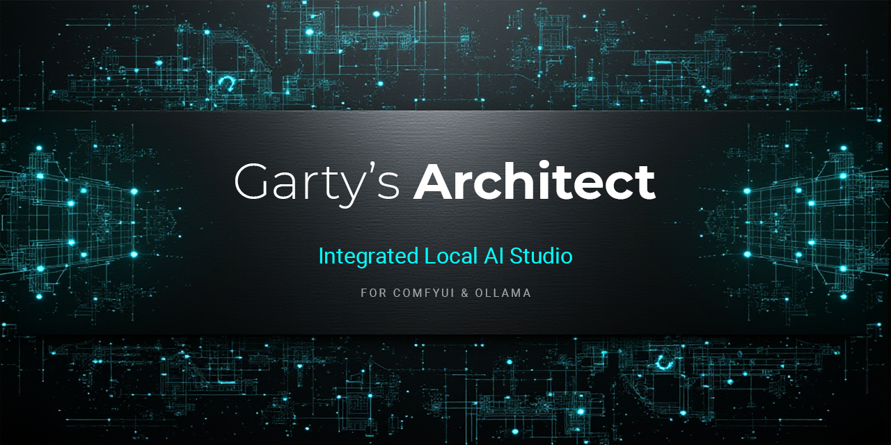

<div align="center">
  
</div>
<br>

# 🏛️ Garty's Architect — Integrated Local AI Studio

[-0078D6?style=for-the-badge&logo=windows)](https://github.com/Gartyl/Gartys-Architect/releases)
[](https://frankenphp.dev/)
[](https://github.com/Gartyl/Gartys-Architect/wiki)
[](https://github.com/Gartyl/Gartys-Architect)

<p align="center">
  <b>🌐 Language / Idioma:</b> &nbsp; 🇬🇧 <b>English</b> &nbsp;|&nbsp; <a href="README.es.md">🇪🇸 <b>Español</b></a>
</p>

Welcome to the official repository for **Garty's Architect**, your local desktop command center for orchestrating generative AI models. Built to bridge the gap between the raw, limitless power of **ComfyUI + Ollama** and the clean, focused experience of a professional creative studio.

**Garty's Architect** is distributed as a **100% standalone, portable application** powered by an embedded **FrankenPHP** server and **SQLite3**. No Python environment conflicts, no Apache/XAMPP setups, and no Docker containers required. Just unzip, launch, and create.

> ⚠️ **Important Note:** Garty's Architect is an advanced orchestration framework and UI. It does **not** distribute, host, or bundle any AI models or checkpoints. You retain full control over your own locally hosted models.

---

## ⚡ Core Features

* 💬 **Unified Multimodal Super-Chat & RAG:** Control ComfyUI and Ollama from a single responsive dark-mode interface. Analyze PDFs/DOCX, perform high-precision OCR on images, query real-time internet data via the built-in **Sniper RAG Engine** (Wikipedia API + DuckDuckGo Lite), customize Chat Personalities, and trigger GPU renders directly using slash commands (`/img`, `/gpu`). Say goodbye to spaghetti nodes!
* 🎨 **Full Modern Image Studio (Free):** Orchestrate classic checkpoints (**SD 1.5, SDXL**) and modern DiT/Unbundled architectures (**Flux, Flux 2/3 Klein, Chroma, Z-Image, Anima, SD 3.5, Krea-2, Qwen-Image/Edit, Hunyuan Image, HiDream, MiniMax H3 Image, Fibo 2.0**) with universal Flow Shift, Personal Presets, ControlNet Studio, ADetailer, Inpainting/Outpainting, and Classic Tiled Upscaling.
* 🤖 **The Auto-Architect (1-Click Semantic Routing — PRO):** Not sure which checkpoint, resolution, or CFG to use? Type your idea in plain language and hit the Magic Wand. Your local LLM reads the semantic tags of your installed models, selects the best engine, adjusts the aspect ratio, writes the technical prompt, and fires the GPU automatically.
* 🎬 **Next-Gen Cinematic Video Studio (PRO):** Native orchestration for **Wan 2.1/2.2, LTX-Video, Hunyuan Video, and MiniMax H3** (including automatic `.safetensors` / `.gguf` switching, dynamic LoRA bypassing, Video Merging, and Multi-Tray reference injection of up to 9 images in a single shot).
* 🔊 **Pro Audio, Voice Cloning & Foley Studio (PRO):** Clone voices with **MiniMax H3 (20B)** (ultra-fast audio-only decoding + automatic FFmpeg silence trimming), **OmniVoice** (Dual-Mode: Zero-Shot Voice Design + Reference Cloning), **IndexTTS-2**, and **F5-TTS**. Generate video-synced sound effects with **HunyuanVideo-Foley**, music with **Stable Audio**, and acoustic prompts with the **AI Music Maestro**.
* 🧠 **Semantic Vector History & YAML Wildcards:** Every prompt and chat response is automatically indexed using local embeddings (`nomic-embed-text`), letting you search your history by *meaning and concept*, not just keywords. Supports inline `{a|b|c}` dynamic syntax and `.yaml` wildcard trees.
* 🔋 **Real-Time Hardware Monitor & Smart VRAM Arbitrator:** Monitor GPU/VRAM/RAM live and configure per-model `keep_alive` policies so Ollama instantly flushes VRAM (`0s`) before ComfyUI starts heavy rendering. Includes an OTA GitHub Auto-Updater that protects user files and safe physical deletion (sending obsolete ComfyUI models to the **Windows Recycle Bin**).
* 🌍 **Multilingual & 100% Private:** Native support for **English, Spanish, and Catalan** (with a live in-app translation editor). Your data, your hardware, your rules.

---

## 💻 Hardware Requirements

Since Garty's Architect communicates directly with your local AI instances, performance depends entirely on your hardware:

* **Minimum Setup (SD 1.5 / SDXL / 8B LLMs):**
  * **CPU:** Modern quad-core processor.
  * **GPU:** NVIDIA GPU with **8 GB VRAM**.
  * **RAM:** 16 GB system memory.
* **Recommended Setup (Flux / DiT / Video Generation / 14B–27B LLMs):**
  * **CPU:** Modern multi-core processor (e.g., Intel Core i7 / AMD Ryzen 7 or higher).
  * **GPU:** NVIDIA RTX series with **16 GB+ VRAM** (e.g., RTX 4060 Ti 16GB, RTX 5060 16GB, RTX 4080, RTX 3090/4090).
  * **RAM:** 32 GB+ system memory.

---

## 🛠️ Quick Start & Installation

Getting started takes less than a minute — **no manual config file editing required**:

1. Download the latest **Garty's Architect `.zip`** from the **[Releases](../../releases)** tab.
2. Extract it into a non-protected folder on your drive (e.g., `C:\GartysArchitect\`). *Avoid `C:\Program Files\` so SQLite and the gallery have write permissions.*
3. Make sure **[Ollama](https://ollama.com)** (`11434`) and **ComfyUI** (`8188`) are running in the background.
4. Double-click **`GartysArchitect.exe`**. It automatically creates your local `config.php`, starts the embedded FrankenPHP server, and **opens your browser** at `http://localhost:8000` *(keep the console window open while using the app)*.
5. In the **Smart Onboarding** screen:
   * Confirm or select your **`ComfyUI/models`** folder in 1 click (common Windows, Portable, and StabilityMatrix paths are auto-detected).
   * Optionally pull the starter LLM (`Llama 3.1 8B + Nomic Embed`) and/or a starter SDXL checkpoint with a live progress bar — or skip straight in if you already have your own models.
6. *(Optional)* Enter your **★ PRO License Key** in the top bar to unlock Video, Audio Pro, Auto-Architect, and advanced studio modules. *(If you use the PRO Civitai Downloader, you can also paste your Civitai API Key in `config.php` under `API_KEY`.)*

---

## 🧠 Prerequisites 1: The Logic Core (Ollama)

Garty's Architect is **100% model-agnostic** — register any model you already have in the Admin Panel. If you are starting from scratch, these baseline roles cover every workflow:

1. **`sys_llm` (Prompt Engineer & Auto-Architect):** `llama3.1:8b` *(or `gemma3:12b` / `deepseek-r1:14b`)*
2. **`sys_vision` (Optical Analyst):** `granite3.2-vision` *(extracts structural tags for ControlNet/IP-Adapter)*
3. **Multimodal Chat Model:** `qwen2.5-vl:7b` *(or `gemma3:27b` — chat, coding & high-accuracy OCR)*
4. **`sys_embed` (Semantic Vector Search):** `nomic-embed-text:latest` *(274 MB — indexes history by concept)*

```powershell
ollama pull llama3.1:8b
ollama pull granite3.2-vision
ollama pull qwen2.5-vl:7b
ollama pull nomic-embed-text:latest
```

*(New users can also pull `llama3.1:8b` + `nomic-embed-text` in **1 click** directly from the Smart Onboarding screen.)*

---

## 🎨 Prerequisites 2: The Render Core (ComfyUI & FFmpeg)

### Ready out of the box (0 mandatory Custom Nodes)
Standard image generation (**SD 1.5, SDXL, Flux, and native ComfyUI DiT architectures**) works immediately with a vanilla ComfyUI installation — no extra nodes required to get your first renders running.

### Optional Custom Nodes (install only the modules you want)
Install via **ComfyUI Manager** as needed (plus **FFmpeg** on your system `PATH` for video merging and voice sample trimming):

* **Quantized Models (.gguf):** `ComfyUI-GGUF`
* **Structure, Repair & Upscaling:** `ComfyUI-Advanced-ControlNet`, `comfyui_controlnet_aux`, `ComfyUI-Impact-Pack` *(ADetailer / Inpaint)*, `ComfyUI_UltimateSDUpscale`
* **Advanced Image Editing:** `ComfyUI-Flux2KontextConditioner`, `ComfyUI-Qwen-Image-Edit`
* **PRO Post-Processing & Style:** `ComfyUI-ReActor` *(FaceSwap)*, `ComfyUI_IPAdapter_plus`, `ComfyUI-Rembg`, `ComfyUI-IC-Light`, `ComfyUI-DDColor`, plus SeedVR2 / AuraSR / LaMa nodes if used
* **PRO Video Packaging:** `ComfyUI-VideoHelperSuite` *(Required for MP4/Audio merging)*
* **PRO Voice Cloning, Foley & Lip-Sync:** `ComfyUI-MiniMax-H3`, `ComfyUI-OmniVoice`, `ComfyUI-IndexTTS`, `ComfyUI-F5-TTS`, `ComfyUI-HunyuanVideo-Foley`, `ComfyUI-Wav2Lip`

---

## 🚀 Editions: Free vs. PRO

### 1. The Core Experience (Free)
Everything you need to run a full local AI image & chat studio without paywalls on modern architectures:
* **Full Image Architectures:** Classic (**SD 1.5 & SDXL**) and modern **Flux / DiT / Unbundled** models (Flux, Flux 2/3 Klein, Chroma, Z-Image, Anima, SD 3.5, Krea-2, Qwen-Image/Edit, Hunyuan Image, HiDream, MiniMax H3 Image, Fibo 2.0) with Flow Shift and Personal Presets.
* **Core Graphic Studio:** **ControlNet Studio**, **ADetailer**, **Inpainting & Outpainting Canvas**, **Classic Tiled Upscaling**, and Multi-Reference Tray (up to 2 images).
* **Super-Chat & Prompting:** Multimodal Chat, Custom Chat Personalities, Sniper RAG web search, Document/OCR analysis, Prompt Architect, Surprise Dice, Dynamic Prompts/Wildcards, and Semantic Vector History (`nomic-embed-text`).
* **System & Onboarding:** Live Hardware/VRAM Monitor, Smart 1-Click Onboarding, SQLite portable storage, and Multilingual UI (EN/ES/CA).
* 👉 **[Download the latest `.zip` from Releases](../../releases)**

### 2. ★ PRO Studio License
Built for power creators, filmmakers, and audio/video pipelines. Unlocks the full arsenal of Garty's Architect:
* **Cinematic Video Studio:** **Wan 2.1/2.2, LTX-Video, Hunyuan Video, and MiniMax H3**, Video Merging, Video Seeds & Styles, and expanded Multi-Reference Tray (up to engine limit: 3–9 images).
* **Full Audio & Voice Cloning Suite:** **MiniMax H3 (20B) Voice Clone, OmniVoice Dual-Mode, IndexTTS-2, F5-TTS**, Saved Voices manager, **HunyuanVideo-Foley, Stable Audio, AI Music Maestro, and Wav2Lip**.
* **Auto-Architect & Power Productivity:** **1-Click Semantic Auto-Architect**, **Batch Folder** processing, **Infinite Loop (∞)**, **XY Lab**, **Benchmarks**, and built-in **Civitai Downloader**.
* **PRO Restoration & Post-Processing:** **SeedVR2** (Image & Video restoration), **AuraSR**, **LaMa Object Remover**, **ReActor (FaceSwap)**, **IP-Adapter / Flux Redux**, **IC-Light**, **DDColor**, and **Rembg**.
* 👉 **[Unlock the PRO License here](https://garty.lemonsqueezy.com/checkout/buy/70636e1a-0dde-49c5-bf97-d4d852dceee8)**

---

## 📖 Official Documentation & Wiki

Every feature — from configuring Unbundled DiT/UNET models and mastering the 4 Voice Cloning engines to VRAM policies and troubleshooting — is documented in the official Wiki:

👉 **[Read the Full Technical Manual in the Official Wiki](../../wiki)**

---

## 🔮 Roadmap

* **Continuous Engine Evolution:** Day-one integration of upcoming open-weights image, video, and audio architectures.
* **The Server Edition:** Dedicated multi-user release for studio networks with MySQL/MariaDB backends, role-based permissions, shared galleries, and audit logs.

---

## 🐛 Bug Reports & Feature Requests

Have an idea or found a bug? Open a ticket in **[Issues](../../issues)**. Before reporting a render issue, verify in the [Troubleshooting Wiki](../../wiki) that your `ComfyUI/models` path, optional Custom Nodes, and Ollama models are properly configured.